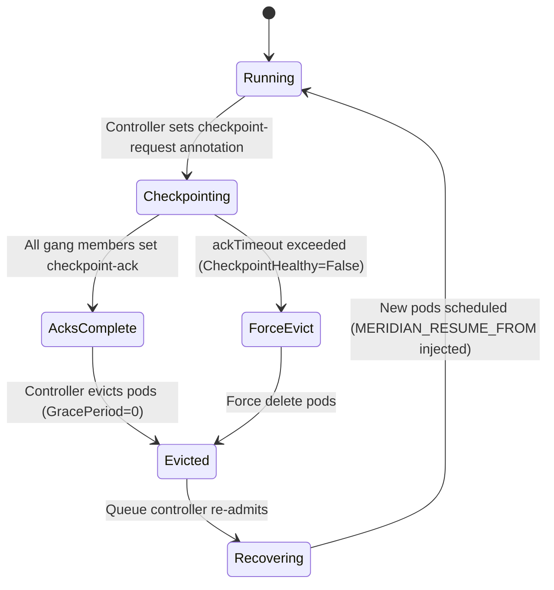
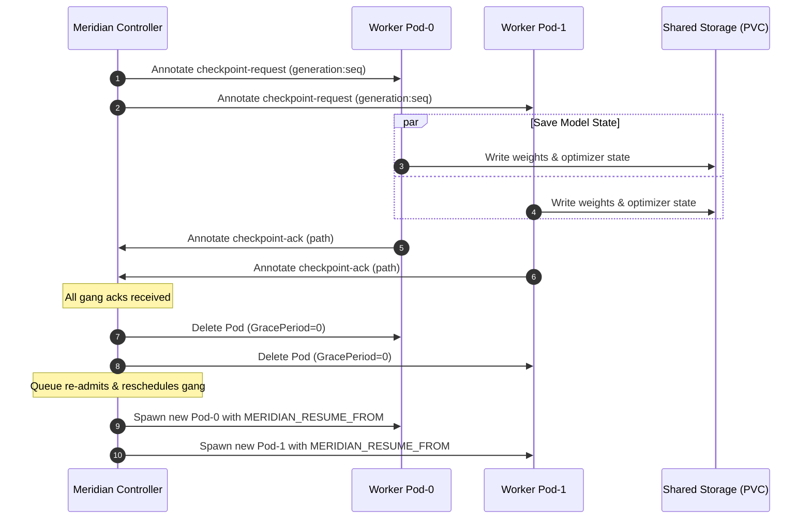

# Checkpoint Protocol Design

**Meridian · docs/design/checkpoint-protocol.md**
**Status:** Implemented (Phase 05)

---

## 1. Motivation

GPU training jobs run for hours or days.  Without controlled checkpointing, preemption loses all progress since the last ad-hoc save.  Meridian implements a **cooperative checkpoint protocol** that lets the control plane request a checkpoint from a running gang, wait for acknowledgment from every member, then safely evict and resume the job from the saved state.

---

## 2. Annotation Contract

All communication between the controller and trainer pods uses Kubernetes pod annotations.  This requires zero extra network endpoints and works with standard RBAC.

| Annotation | Set by | Format | Meaning |
|---|---|---|---|
| `meridian.dev/checkpoint-request` | Controller | `"<generation>:<seq>"` | Request checkpoint at generation G, sequence S |
| `meridian.dev/checkpoint-ack` | Trainer (via `ckptclient`) | `"<generation>:<seq>:<path>"` | Ack for sequence S; checkpoint written to `path` |
| `meridian.dev/checkpoint-heartbeat` | Trainer | RFC3339 timestamp | Liveness; updated on every training step |
| `meridian.dev/checkpoint-step` | Trainer | integer string | Most recently completed training step |

`generation` matches the `GPUWorkload.Generation` at the time of the checkpoint request, ensuring no stale ack from a prior generation is accepted.

---

## 3. Protocol State Machine



---

## 4. Controller Responsibilities (`internal/checkpoint`)

### 4.1 RequestCheckpoint

1. Compute `seq = lastCheckpointSeq + 1`.
2. Patch annotation `meridian.dev/checkpoint-request: "<generation>:<seq>"` onto **all** gang member pods via Server-Side Apply.
3. Set `GPUWorkload.Status.Phase = Checkpointing`.
4. Record `CheckpointRequestedAt` in status.

### 4.2 WaitForAcks

Poll (via informer cache) all gang member pods for `meridian.dev/checkpoint-ack` matching the expected `<generation>:<seq>`.
- Extract the checkpoint path from each ack.
- Once **all** members acked: call `CompleteCheckpoint`.
- If deadline (`CheckpointRequestedAt + ackTimeout`) exceeded: call `TimeoutCheckpoint`.

### 4.3 CompleteCheckpoint

1. Record `LastCheckpointAt`, `LastCheckpointPath` (path from the last acked annotation), `LastCheckpointStep` in `GPUWorkload.Status`.
2. Set condition `CheckpointHealthy=True`.
3. Delete gang pods (triggers eviction → Recovering).

### 4.4 TimeoutCheckpoint

1. Set condition `CheckpointHealthy=False`, reason `AckTimeout`.
2. Record event: `Warning CheckpointTimeout "gang member <pod> did not ack within <ackTimeout>"`.
3. Force-delete all gang pods regardless.
4. Set `GPUWorkload.Phase = Recovering` with a note that the resume may be from a prior checkpoint.

### 4.5 InjectResumeEnv

When creating new generation pods in `Recovering → Scheduling`:
- Set env `MERIDIAN_RESUME_FROM=<LastCheckpointPath>` if `LastCheckpointPath` is non-empty.
- Set env `MERIDIAN_RESUME_STEP=<LastCheckpointStep>` for trainer introspection.

---

## 5. Trainer Library (`pkg/ckptclient`)

```go
// Client is the trainer-side checkpoint library.
// Import it in a training binary to participate in the Meridian checkpoint protocol.
type Client struct { ... }

// New creates a Client using in-cluster config.
// podNamespace and podName are typically read from the Downward API.
func New(ctx context.Context, podNamespace, podName string) (*Client, error)

// Watch starts a background goroutine that polls the pod's own annotation.
// When a checkpoint-request annotation is detected (and not yet acked),
// it calls handler(ctx, req) where req.Path is the suggested write path.
// handler must write the checkpoint synchronously and return the actual path.
// Watch returns immediately; call Stop() to shut down.
func (c *Client) Watch(ctx context.Context, handler CheckpointHandler)

// Ack patches the checkpoint-ack annotation onto the pod.
// Called automatically by Watch after handler returns successfully.
func (c *Client) Ack(ctx context.Context, req CheckpointRequest, actualPath string) error

// ResumeFrom returns the value of MERIDIAN_RESUME_FROM env var, or empty string.
func ResumeFrom() string

// ResumeStep returns the value of MERIDIAN_RESUME_STEP env var (0 if absent).
func ResumeStep() int64

// Stop cancels the Watch goroutine.
func (c *Client) Stop()
```

### 5.1 Polling Interval

The client polls its own pod annotation every `PollInterval` (default 2s).  On detection of a new request:
1. Lock to prevent concurrent checkpoint.
2. Call handler.
3. On success: patch ack annotation.
4. On error: log + retry up to `MaxRetries` times before giving up (controller will timeout-evict).

### 5.2 Heartbeat

The client also patches `meridian.dev/checkpoint-heartbeat` on every training step (via `Heartbeat(step int64)` call from the trainer loop).  The controller uses this to detect stragglers — pods that have not updated their heartbeat within `straggler_window` (default 60s).

---

## 6. Elastic Restart

If `GPUWorkload.Spec.Elastic.Enabled = true` and cluster capacity is insufficient to restart at the original `gangSize`:
1. Controller calculates the largest valid restart size (must be a valid divisor from `Spec.Elastic.ValidSizes`, default: `[gangSize, gangSize/2, gangSize/4]`, all ≥ 1).
2. Creates new pods at the smaller size.
3. Sets `GPUWorkload.Status.CurrentGangSize = <new size>`.
4. Trainer detects `MERIDIAN_RESUME_SIZE` env and adjusts its data-parallel world size.

---

## 7. Straggler Detection Policy

A pod is a **straggler** if:
- `checkpoint-heartbeat` age > `straggler_window` (default 60s), AND
- the workload is in `Running` phase.

Policy (conservative, documented):
- **Alert only** (default): emit event `Warning StragglersDetected`.
- **Restart** (opt-in via `Spec.StragglerPolicy: Restart`): trigger checkpoint request, evict the entire gang, resume.

---

## 8. Sequence Diagram (Happy Path)



---

## 9. Failure Modes and Mitigations

| Failure | Detection | Response |
|---|---|---|
| Pod crashes before ack | Pod goes NotReady | Controller detects missing ack at deadline → timeout-evict all; resume from prior checkpoint |
| Controller crashes mid-wait | On restart, re-reads annotations; re-checks acks | Idempotent: if acks already written, `CompleteCheckpoint` fires normally |
| Checkpoint write fails | handler returns error | Trainer library retries; if all retries fail, controller timeout fires |
| NFS/PVC unavailable | handler returns error | Same as above; CheckpointHealthy=False |
| ackTimeout too short | Partial acks received | Increase via `GPUWorkload.Spec.Checkpoint.AckTimeout` |

---

## 10. Configuration

In `GPUWorkload.Spec.Checkpoint`:
```yaml
checkpoint:
  enabled: true
  interval: 10m        # controller-requested interval (recurring checkpoints)
  ackTimeout: 5m       # max wait for all acks before force-evict
  path: /mnt/ckpt      # base path trainer should write checkpoints to
```

---

*Last updated: Phase 05 implementation.*
