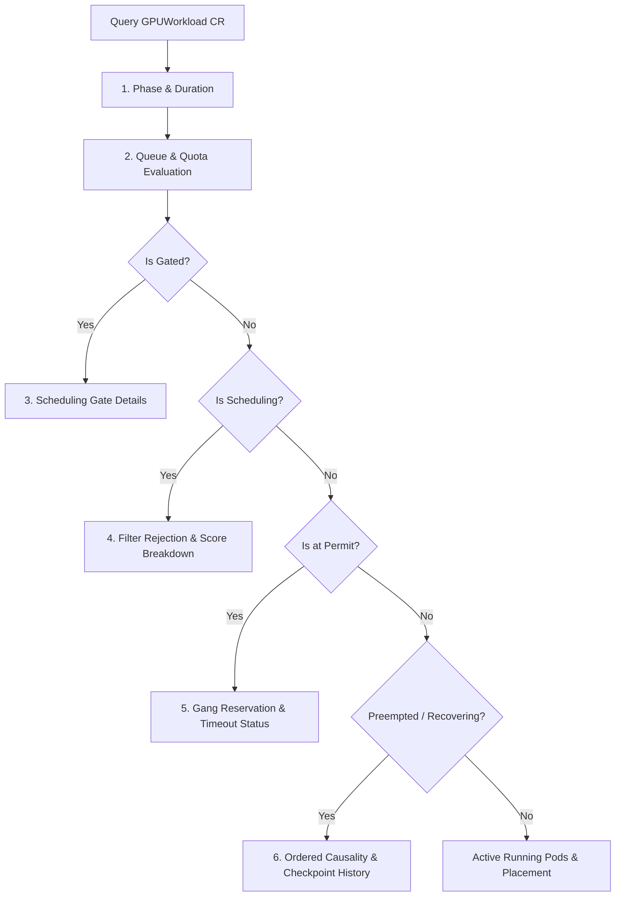

# Meridian Decision Records & Explainability Architecture

## 1. Overview & Objectives

In large-scale AI/GPU clusters, the most frustrating failure mode for infrastructure operators and ML engineers is a **stuck or rejected workload with no clear explanation**. Default Kubernetes schedulers and workload controllers emit opaque events such as:
```
0/32 nodes are available: 32 Insufficient nvidia.com/gpu. Preemption: 0/32 nodes are available.
```
This fails to tell the engineer:
- Which nodes had enough GPUs but failed topology alignment (e.g., cross-NVLink domain)?
- Which nodes were tainted because of GPU hardware faults (e.g., XID 79)?
- Is the workload blocked at queue admission, waiting for borrowable quota, or gated?
- How many gang members have been reserved at Permit, and when does the gang timeout expire?
- If the workload was preempted or recovering, what was the causal timeline?

Meridian solves this with **Explainability by Design**:
1. **Decision Ring Buffer** (`internal/scheduler/decisions`): Bounded in-memory recorder tracking per-node filter verdicts and composite scoring breakdowns.
2. **Explainability Engine** (`internal/explain`): Consolidates real cluster state, queue admission quotas, scheduling gates, gang permit states, and CR status history into structured, diagnostic explanations.
3. **CLI** (`cmd/meridianctl`): Exposes `meridianctl explain workload`, `meridianctl explain inference`, and `meridianctl status cluster`.
4. **Causal Tracing** (`internal/telemetry/tracing`): OpenTelemetry distributed tracing across admission, gating, scheduling, permit, bind, and container execution with monotonic sequence numbering (`seq`).

---

## 2. Memory Bounds & Ring Buffer Guarantees

As specified in `Meridian.md` §12, the decision recorder must never allow unbounded heap growth:

| Parameter | Value | Rationale |
|---|---|---|
| `MaxPodsRetained` | 1024 | Holds recent scheduling decisions for active/recent pods |
| `MaxNodesPerPod` | 256 | Holds decisions for up to 256 candidate nodes per scheduling cycle |
| Decision Struct Size | ~256 bytes | Compact representation (verdict, reason, sub-scores) |
| **Worst-case Heap** | **~64 MiB** | `1024 × 256 × 256 bytes ≈ 67,108,864 bytes` |

When a new pod arrives beyond `MaxPodsRetained`, the oldest pod's records are purged using FIFO eviction. Within a single pod's record list, decisions exceeding `MaxNodesPerPod` drop the oldest node evaluation.

---

## 3. Explainability Pipeline & Diagnostic Sequence

When an operator runs:
```bash
meridianctl explain workload <name> -n <ns>
```
The explain engine inspects real live data in strict order:



### 3.1 Step Breakdown

1. **Current Phase & Duration**:
   - Calculates time in current phase using `LastTransitionTime` from workload conditions.
2. **Queue Status & Quota**:
   - Checks `GPUQueue` allocated quota, limit, and borrowable allowance.
   - If blocked at admission, lists which active workloads are currently holding the quota.
3. **Scheduling Gate**:
   - Checks if pods carry `meridian.dev/admission` gate; explains why gate is closed.
4. **Per-Node Rejection Summary & Scoring**:
   - Rejection reasons grouped and counted:
     - `X nodes: Insufficient nvidia.com/gpu`
     - `Y nodes: Topology constraint (NVLink / Rack) unmet`
     - `Z nodes: Unhealthy taint (meridian.dev/gpu-unhealthy)`
   - Displays top 3 candidate nodes with fit, topology, health, and composite scores.
5. **Permit Gang Status**:
   - Compares reserved gang pods vs `minAvailable`.
   - Shows remaining time before `permitTimeout` eviction.
6. **Preemption & Recovery History**:
   - Traverses `workload.Status.History` to report preemption reasons (e.g. victim of higher priority workload), checkpoint ack duration, or hardware fault detection.

---

## 4. OpenTelemetry Distributed Tracing

Spans are rooted at `workload.UID` and trace the complete lifecycle:
```
[Admission Reconcile] (seq=1)
  └── [Gate Release] (seq=2)
        └── [Scheduler PreFilter / Filter / Score] (seq=3)
              └── [Permit Wait] (seq=4)
                    └── [Pod Bind] (seq=5)
                          └── [Trainer Container Exec] (seq=6)
```
Every workload event carries an incremental `seq` integer ensuring strict causal ordering even across clock skew. Spans are exported via standard OTLP gRPC.
