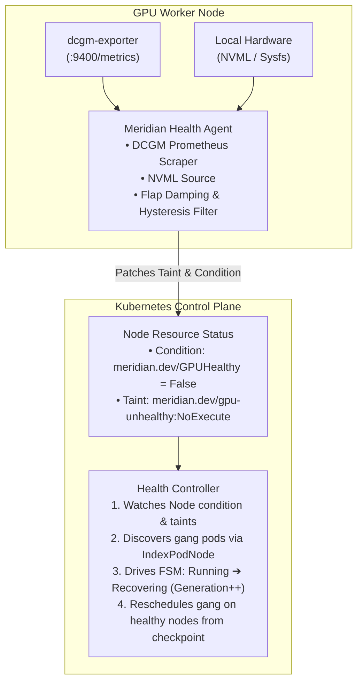

# Node Health, NVML/DCGM Telemetry, and XID Classification

**Meridian · docs/design/node-health-and-xid.md**  
**Status:** Implemented (Phase 06)  

---

## 1. Overview

In multi-node distributed GPU training, a single GPU hardware anomaly (e.g. PCIe bus drop, uncorrectable double-bit memory error, thermal throttling) halts or corrupts the entire gang. Meridian deploys a lightweight node agent as a DaemonSet to continuously monitor accelerator hardware health, classify faults by severity, apply flap-damped Kubernetes taints and conditions, and trigger fast gang recovery.

---

## 2. Architecture

---

## 3. XID Fault Classification Table

NVIDIA GPUs report hardware and software fault codes through the driver event log known as **XID errors**. Meridian classifies these into **Fatal** (requiring immediate gang eviction via `NoExecute`) and **Recoverable** (degraded, requiring `NoSchedule` to prevent new admissions):

| XID | Category | Severity | Description | Action |
|:---:|:---|:---:|:---|:---|
| **31** | Memory | **Fatal** | GPU memory page fault | Evict gang, taint `NoExecute` |
| **43** | Driver/HW | **Fatal** | GPU stopped processing (hang) | Evict gang, taint `NoExecute` |
| **45** | Engine | **Fatal** | Preemptive cleanup failed | Evict gang, taint `NoExecute` |
| **61** | Hardware | **Fatal** | Internal micro-controller breakpoint | Evict gang, taint `NoExecute` |
| **62** | Internal | **Fatal** | Internal micro-controller halt | Evict gang, taint `NoExecute` |
| **63** | Memory | **Fatal** | ECC Page retirement table full | Evict gang, taint `NoExecute` |
| **64** | Memory | **Fatal** | ECC uncorrectable error (DBE) | Evict gang, taint `NoExecute` |
| **74** | NVLink | **Fatal** | NVLink unrecoverable error | Evict gang, taint `NoExecute` |
| **79** | PCIe | **Fatal** | GPU fell off the bus | Evict gang, taint `NoExecute` |
| **92** | Thermal | **Fatal** | High temperature shutdown | Evict gang, taint `NoExecute` |
| **13** | Graphics | **Recoverable** | Driver graphics engine error | Drain gracefully, taint `NoSchedule` |
| **44** | Hardware | **Recoverable** | Graphics engine fault recovery | Degraded, taint `NoSchedule` |
| **54** | Auxiliary | **Recoverable** | Thermal throttling active | Degraded, taint `NoSchedule` |
| **68** | NVLink | **Recoverable** | NVLink degradation / reduced bandwidth | Degraded, taint `NoSchedule` |

---

## 4. Node Conditions & Taints Contract

### Conditions
- **`meridian.dev/GPUHealthy`**:
  - `Status: "True"`: All GPUs healthy, normal operation.
  - `Status: "False"`: Hardware fault, bus drop, or uncorrectable ECC detected.
  - `Reason`: E.g. `XIDFatalError`, `ECCUncorrectableError`, `ThermalShutdown`, `GPUFellOffBus`.

### Taints
- **`meridian.dev/gpu-unhealthy:NoExecute`**:
  Applied when a **Fatal** fault is detected. Kubernetes immediately evicts running pods from the node.
- **`meridian.dev/gpu-unhealthy:NoSchedule`**:
  Applied when a **Recoverable** or degraded fault is detected. Existing workloads may complete or checkpoint gracefully, but the scheduler rejects new placements.

---

## 5. Flap Damping & Hysteresis

Hardware sensors can report intermittent spikes or transient recoveries (e.g. temperature momentarily dipping below threshold). To avoid rapidly cycling node taints and churning workloads:

1. **Immediate Fault Trigger**: A single fatal or degraded fault triggers the unhealthy taint immediately (0-lag safety).
2. **Hysteresis Recovery Window**: A node is NOT untainted until it has completed **N consecutive healthy scrape intervals** (default: `3` cycles over `15s`) without any reported errors.
3. **Flap Count Backoff**: If a node transitions between healthy and unhealthy more than `MaxFlaps` (default: 3) within `FlapWindow` (default: 5m), the node is locked in `Quarantine` for an extended period (`QuarantineDuration` = 15m).
