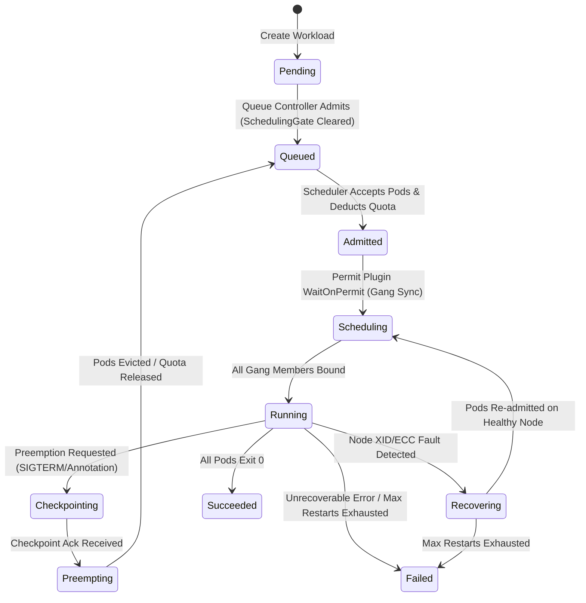

# Design: GPUWorkload Finite State Machine (FSM)

## State diagram




## FSM implementation

The FSM is implemented in `internal/fsm/workload_fsm.go`. Each transition is a pure
function `(currentPhase, input) → nextPhase` to make it independently testable.

```go
// Transition encodes a valid FSM edge.
type Transition struct {
    From  GPUWorkloadPhase
    Event WorkloadEvent
    To    GPUWorkloadPhase
}

// Apply returns the next phase for the given event, or an error if the
// transition is not valid from the current phase.
func (f *WorkloadFSM) Apply(phase GPUWorkloadPhase, event WorkloadEvent) (GPUWorkloadPhase, error)
```

The workload controller calls `fsm.Apply` in every reconcile cycle and then writes the
result back to `status.phase` via server-side apply. Because transitions are pure
functions, the controller is crash-safe: if it restarts between computing the next
phase and writing it, the next reconcile recomputes the same transition.

## Idempotency invariant

Every state transition must be safe to apply multiple times. This is enforced by:

1. **Guard conditions**: the controller checks the current phase from the cached status
   before deciding what to do. If status already reflects the expected phase, the
   reconcile is a no-op.
2. **Server-side apply**: status patches use `apply` (not `update`), so concurrent
   managers do not clobber each other's writes.
3. **Finalizer protocol**: pods are only deleted after the finalizer confirms the
   checkpoint path has been recorded. If the controller crashes mid-delete, the next
   reconcile finds the undeleted pods and retries gracefully.

## Phase predicates used by other controllers

The queue controller and scheduler use phase predicates to drive admission:

```go
// IsActive returns true if the workload is occupying quota.
func IsActive(phase GPUWorkloadPhase) bool {
    return phase == WorkloadPhaseRunning ||
        phase == WorkloadPhaseCheckpointing ||
        phase == WorkloadPhasePreempting ||
        phase == WorkloadPhaseRecovering
}

// IsTerminal returns true if the workload will never need re-admission.
func IsTerminal(phase GPUWorkloadPhase) bool {
    return phase == WorkloadPhaseSucceeded || phase == WorkloadPhaseFailed
}
```

## Testing the FSM

The FSM is tested at three levels:

1. **Unit tests** (`internal/fsm/workload_fsm_test.go`): table-driven tests that
   verify every valid edge and that invalid transitions return an error.
2. **Envtest integration** (`test/envtest/workload_controller_test.go`): full
   reconcile cycle against a real apiserver. Crash-restart tests kill the controller
   mid-reconcile and verify convergence to the correct terminal phase.
3. **E2e** (`test/e2e/checkpoint_preemption_test.go`): exercises the full
   Running → Checkpointing → Preempting → Pending → Running path on kind with a
   real scheduler and vllm-emu trainer.
